# 联系我们

如果您想使用功能更完善的能碳管理平台系统，请联系以下企业微信！ 如果您想基于能碳系统进行定制开发，我们提供有偿定制服务支持！ 其他合作模式不限，欢迎来撩！

## 体验账号

- **体验地址**：[点击跳转到能源管理平台](https://changyangdt.com/energyView/)
- **账号**：changyang123
- **密码**：Erty1234!

---

# 碳能智云\-开源文档介绍

# 碳能智云

> 面向工业园区、制造企业、集团企业和双碳服务商的一站式能碳管理平台，覆盖能源采集、用能分析、碳核算、产品碳足迹、供应链碳协同、碳资产与碳中和管理等业务场景。
>
>

## 产品简介

碳能智云是一套综合能碳管理平台，帮助企业把分散的能源数据、碳排放数据、核算模型、排放因子、供应链碳数据和管理流程统一到一个数字化系统中。平台可用于企业内部节能降碳管理，也可作为开源市场中的能碳管理应用说明和项目评估资料。

碳能智云采用"端\-边\-云"协同的**六层架构**，自下而上覆盖从数据采集到应用呈现的全链路，**完整对应《工业企业和园区数字化能碳管理中心建设指南》，提出的六大层系统架构要求**：

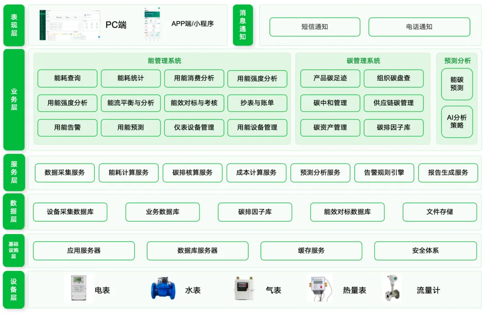

**平台核心目标：**

- 建立企业能源与碳排放的数据底座。

- 通过看板、查询、统计、分析和告警提升能源管理效率。

- 支持企业碳盘查、产品碳足迹、供应链碳数据协同等双碳业务。

- 支持按业务场景进行功能评估、二次开发和行业化扩展。

## 适用场景

① 绿色工厂 / 绿色园区申报

申报需要系统化的能、碳数据支撑，手工整理费时易错。碳能智云统一汇聚能耗与碳排放数据，一键生成符合规范的申报支撑材料，**材料准备周期可缩短约 50%**。

② 日常能源管理，节能降耗

高耗能环节难定位、节能改造靠经验。用能预测 AI 分析报告自动识别能耗异常、预测用能趋势，输出可执行的节能策略。

③ 组织碳盘查与碳信息披露

标准多、口径杂，年度碳盘查周期长、人力重。国标行业模板固化核算规则，快速完成组织碳盘查并输出标准报告，从容应对监管与披露要求，**碳盘查周期由数周压缩至数天**。

④ 产品碳足迹核算（出口与供应链）

下游客户与海外法规对产品碳足迹提出要求，核算链条长。工艺流程模板库快速搭建核算流程，输出碳足迹标签与报告，满足披露与合规需求。

⑤ 集团 / 多基地统一能碳管控

多工厂、多层级数据分散，难统一考核。平台支持集团\-工厂多级架构，能耗与碳排放统一看板、对标与考核，**多基地汇总从月级提速至准实时**，全局一目了然。

## 核心能力

- **工作台**：统一承载待办、快捷入口和关键业务概览。

- **AI小助手**：以问答方式辅助用户理解平台功能和业务数据。

- **能耗查询**：覆盖实时能耗和历史能耗查询，支持多粒度趋势分析。

- **用能统计**：围绕分组、设备等对象统计能耗、折标煤与碳排放。

- **能耗分析**：提供综合能耗、消费、强度、碳排和能流平衡分析。

- **能效对标**：支持能效指标库、行业模板、指标配置、对标和考核。

- **抄表管理**：支持自动抄表、在线记录和人工补录。

- **用能账单管理**：通过计费、结算和账单中心完成能源费用核算与成本分析。

- **告警中心**：覆盖用能告警、设备告警及历史记录留存。

- **用能预测**：结合历史能耗和业务数据进行智能预测。

- **企业碳盘查**：支持企业碳盘查、核算模板、排放源库、强度管理和报告生成。

- **产品碳足迹**：支持产品碳足迹核算、工艺模板、报告、标签与看板。

- **供应链碳管理**：覆盖供应商、采购品、碳数据协同填报和客户侧管理。

- **AI报告**：基于 AI 对能源与碳数据进行分析并生成策略报告。

- **碳中和管理**：管理碳中和目标、碳排计划和减排项目。

- **碳资产管理**：支持碳账本、碳趋势和碳资产预测。

- **碳排因子库**：提供组织因子、系统因子和收藏因子管理。

- **基础信息管理**：维护数据、场站、分组、参数、协议和公式等基础资料。

- **仪表设备管理**：统一管理计量表、传感器和实时监测数据点。

- **用能设备管理**：维护用能设备类型、设备档案和运行分析。

- **系统管理**：管理企业信息、部门、用户、角色和职务。

## 快速使用流程

1. **登录系统**：用户通过浏览器访问系统地址，输入账号和密码登录。登录后进入主界面，可通过顶部导航、左侧菜单和主内容区完成业务操作。

2. **维护基础资料**：先配置组织、场站、用能分组、参数、协议、品牌型号、计算公式库等基础信息，为后续能源统计和碳核算提供数据基础。

3. **接入计量与设备**：配置计量表、传感器、数据点和用能设备档案，形成能源数据采集与设备运行分析基础。

4. **开展能源管理**：使用实时能耗、历史能耗、分组统计、设备统计、能耗分析、能效对标、抄表、账单和告警能力，完成日常能源运营。

5. **开展双碳业务**：基于设施活动、排放源、核算模板、排放因子和活动数据，完成企业碳盘查、产品碳足迹、供应链碳协同、碳中和和碳资产管理。

6. **生成报告与闭环优化**：系统可输出碳盘查报告、产品碳足迹报告、碳足迹标签，并通过 AI 报告辅助识别节能降碳策略。

## 管理端功能清单

|**一级模块**|**二级模块**|**功能描述**|
|---|---|---|
|工作台|工作台|待办任务、菜单快捷入口等功能。|
|BI看板|BI看板|提供企业能源、碳排放、能效等多维数据可视化分析能力，支持通过自定义图表、指标卡、趋势分析等方式构建管理驾驶舱，辅助企业能源管理决策。|
|AI小助手|AI小助手|智能助手，问答形式给用户答疑解惑。|
|能耗查询|实时能耗|实时采集并展示计量表瞬时变量数据，支持按 1 分钟、15 分钟、小时等时间粒度查看实时及历史数据，并通过图表展示变化趋势。|
||历史能耗|支持按年、月、日、小时查询多个计量表的历史用能数据，提供总量、平均值、最大值、最小值等统计分析，并可视化展示变化趋势。|
|用能统计|分组用能统计|按用能分组统计能耗、折标煤及碳排放数据，支持多时间维度查询与分析，为能源管理提供分类统计依据。|
||用能设备用能统计|统计各用能设备的能耗、折标煤及碳排放数据，支持按年、月、日、时进行查询与分析。|
|能耗分析|综合能耗分析|对企业各场站的能耗、碳排放进行综合分析，支持用能结构分析、用能趋势分析等。|
||用能消费分析|从用能强度、能源结构、负荷曲线、消费趋势等维度分析各用能分组的能源消费情况，支持基准期与统计期对比分析。|
||用能强度分析|支持对公式、场站、用能分组，自定义单位产品能耗、单位产值能耗等关键用能强度指标，并提供指标趋势分析。|
||用能碳排分析|统计分析各用能单元及分组的碳排放情况，支持碳排趋势、结构占比及对比分析。|
||能流平衡与分析|支持自定义构建能流图的能源流向关系，直观展示能源流转全过程，自动计算各环节能量损耗率。|
|能效对标|能效对标库|建立企业能效指标标准库，支持设备、工序、生产线及工艺等多维度能效基准管理。|
||指标行业模板|提供不同行业能效指标体系及对标标准，支持企业快速引用行业基准开展能效分析与水平评估。|
||能效指标配置|支持针对公司、场站、用能分组等用能单元配置能效指标，并自定义指标计算公式。|
||能效对标|支持针对公司、场站、用能分组等用能单元进行企业内部横向对标和历史纵向对标。|
||能效考核|建立组织及人员能效考核机制，支持月度、季度、年度考核及考核结果统计分析。|
|抄表管理|抄表方案|支持按场站配置自动抄表方案，按照设定周期自动采集计量数据，实现无人值守抄表。|
||在线抄表记录|自动生成在线计量表的抄表记录。|
||人工抄表|支持离线计量设备的数据人工填报，满足无法自动采集场景下的数据录入需求。|
|用能账单管理|计费方案|配置能源计费规则及费率方案，并关联计量设备，实现能源费用自动计算。|
||结算方案|支持为不同组织、部门配置能源结算方案，实现能源费用核算。|
||用能账单中心|根据结算方案自动生成各组织、部门的能源账单，支持账单以及账单详情查询。|
||用能成本分析|对已归档的用能账单进行成本分析。|
|告警中心|用能告警|支持针对公司、组织、用能分组等用能对象，设置用能告警规则，并通过短信、邮件等方式及时通知。|
||用能告警记录|留存用能告警的告警历史记录。|
||设备告警|支持针对设备状态、设备参数设置告警规则，并通过短信、邮件等方式及时通知。|
||设备告警记录|留存设备告警的告警历史记录。|
|用能预测|用能预测|内置多种预测模型，结合历史能耗及产量、排产等业务数据进行智能预测，支持模型自动推荐及手动选择。|
|企业碳盘查|企业碳盘查看板|集中展示企业碳盘查结果，支持按组织、核算主体、排放范围等维度查看碳排放总量、排放结构、变化趋势及关键指标，为企业碳排放管理与决策提供数据支撑。|
||企业碳盘查|查看各核算主体的碳盘查执行情况，支持按组织、时间及核算边界开展企业碳盘查，并形成碳排放核算结果。核算完成后，支持自动生成以及下载标准的企业碳盘查报告。|
||GHG\+ISO标准，通用算法模型|支持基于 GHG Protocol 与 ISO 14064 等国际通用标准构建碳排放核算模型，采用碳排放因子法对各类排放源进行量化计算，实现企业碳排放规范化核算。|
||国家行业标准\+公式算法|支持国家及行业碳排放核算标准，结合行业特点建立专属算法模型，并支持自定义计算公式配置，实现不同业务场景下碳排放量核算。|
||碳盘查模版|用户可自定义创建碳核算模板，基于模板快速开展企业碳盘查。|
||行业模板库|平台沉淀各行业产品碳足迹核算标准模板，涵盖行业核算边界、排放源、计算规则等内容，用户可快速套用行业模板开展产品碳足迹核算。|
||设施活动管理|对企业排放设施及生产经营活动进行统一管理，支持新增、编辑、删除、查询，为碳排放数据采集与核算提供基础支撑。|
||碳排强度管理|对企业及各部门的碳排放强度指标进行维护、统计与分析，支持按组织维度查看碳排强度变化情况。|
||企业排放源库|管理企业碳盘查核算所涉及的最小颗粒度排放源，支持新增、编辑、删除及后续核算过程快速引用，实现数据复用。|
|产品碳足迹|碳足迹看板|提供产品碳足迹数据可视化看板，支持产品的单批次碳足迹核算结果分析以及多批次对比分析。|
||产品碳足迹|支持产品基础信息管理及产品碳足迹核算，可创建产品核算模型按不同核算周期和核算边界开展碳足迹数据填报、计算与结果分析。|
||通用算法模型|基于碳排放因子法的碳排计算模型|
||公式算法模型|结合行业特点建立专属算法模型，并支持自定义计算公式配置，实现不同业务场景下碳排放计算。|
||碳足迹报告|自动生成产品碳足迹报告及核算清单，支持在线预览、下载导出。|
||碳足迹标签|根据已完成的产品碳足迹核算结果生成碳足迹标签，支持图片导出及二维码展示，实现产品碳足迹信息快速查询。|
||产品工艺模板|对产品工艺流程进行统一管理，可关联排放源信息，创建产品工艺模板，支持模板化复用，减少产品碳足迹核算过程中的重复配置。|
||产品工艺模板库|平台提供各行业典型产品生产工艺流程模板，包含工序流程、工艺环节及关联排放源等信息，用户可直接选择引用，快速构建产品碳足迹核算流程。|
||产品排放源库|管理产品碳足迹核算所涉及的最小颗粒度排放源，支持新增、编辑、删除及后续核算过程快速引用，实现数据复用。|
|供应链碳管理|供应商管理|企业供应商的基本信息管理，支持邀请、管理供应商信息|
||采购品管理|企业采购品基本信息管理。|
||供应商碳数据管理|管理供应商碳盘查数据、产品碳足迹数据，邀请填写、审核数据|
||客户管理|供应商侧，管理邀请人的邀请信息。|
||碳数据填报任务|供应商侧，被邀请的供应商对碳数据填报里完成对应的数据填报。|
|AI报告|AI报告|基于 AI 大模型对企业能源数据以及碳数据进行智能分析，识别节能潜力，并提供能效优化、运行调优及节能降碳策略建议并生成报告。|
|碳中和管理|碳中和目标概览|展示目标的完成情况、减排数据情况以及各年数据趋势概览。|
||碳排计划|设置具体的碳排计划以及阶段规划配置。|
||减排项目管理|设置组织内减碳项目，配置项目预期完成周期、预期减排后的减排量以及对应成本、收益。|
|碳资产管理|碳账本|按不同核算组织查看、记录、管理碳资产「碳配额、碳信用CCER」等信息，支持新增减少流水|
||碳趋势|支持查看不同试点城市以及全国每日的碳市场的价格趋势、成交量趋势|
||碳资产预测|支持对核算周期内的碳配额预测、碳资产预测与结论分析支持利用算法对下一年碳排放量、以及预计碳配额的预测分析与建议|
|碳排因子库|组织因子库|用户组织内自定义添加的碳排因子，在用户本组织内使用；|
||碳排因子库|平台提供给用户的各大认证的权威碳排因子库，支持查询、引用组织因子。包括UK GHG conversion factors 、IPCC 排放源系数库、台湾温室气体排放系数库、台湾环保署碳足迹系数库、中国产品全生命周期温室气体排放系数库。|
||收藏因子|用户收藏的因子列表。|
|基础信息管理|数据管理|支持企业碳盘查、产品碳足迹核算的所需要的活动数据管理。|
||场站管理|管理企业能源场站基础信息，支持配置场站属性、能源类型及组织归属。|
||用能分组管理|建立能源统计分组体系，作为能耗统计、分析及考核的基础管理维度。|
||参数配置|统一维护各能源类型的碳排放因子、折标煤系数及相关计算参数，为能耗与碳排核算提供依据。|
||品牌型号|统一维护设备品牌、型号等基础信息，便于设备标准化管理。|
||协议管理|管理设备通信协议，可新增运算型数据点，实现数据点扩展。|
||计算公式库|用于组织碳排计算、碳足迹计算的计算公式库。|
|仪表设备管理|计量表管理|统一管理计量设备及数据采集方式。|
||传感器管理|对各类传感器设备进行统一管理。|
|用能设备管理|用能设备类型|建立设备类型模板，统一维护不同类型设备的参数模型，支持设备快速配置与复用。|
||用能设备管理|管理企业用能设备基础信息，支持关联计量设备及传感器，并维护额定参数、运行参数、能耗参数及产能参数。|
||设备运行分析|实时监测设备运行状态及关键参数，支持历史数据查询及运行趋势可视化分析。|
|系统管理|企业信息|企业信息，注册的企业信息。|
||部门管理|默认注册认证的企业为一级组织，管理员可在系统中创建新的组织。|
||用户管理|管理员可自由添加新的用户，并绑定组织。|
||角色管理|创建不同的角色，并为角色创建不同的菜单权限，添加授权用户。|
||职务管理|企业职务管理。|

## 四大亮点功能，让合规更省力

**亮点一：用能预测 AI 分析报告**

传统节能多依赖经验，难以精准定位高耗能环节。碳能智云把“预测”和“诊断”打通，形成数据驱动的闭环：

· 多模型智能预测

内置多种预测模型，融合历史能耗与产量、排产等业务数据，智能预测用能需求，支持模型自动推荐与手动选择。

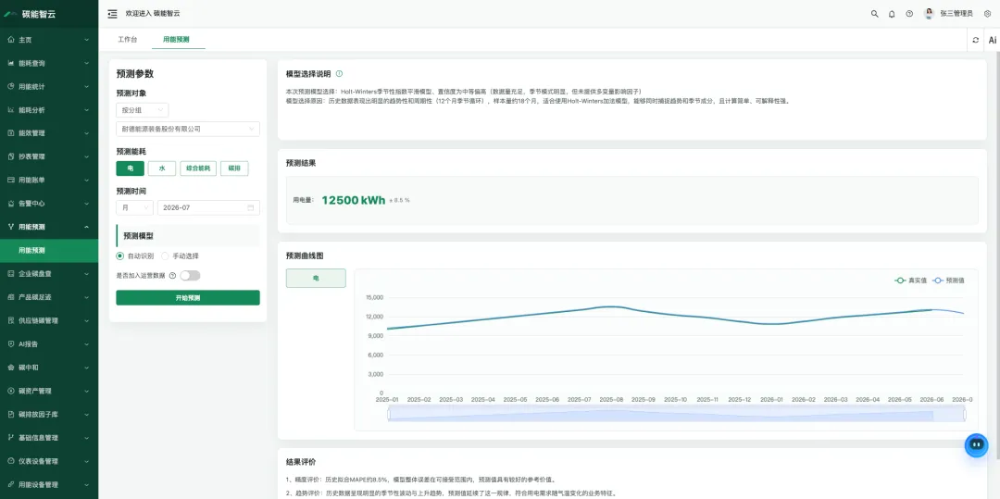

· AI 诊断与策略推荐

基于 AI 大模型对用能、组织碳排、产品碳足迹数据进行分析诊断，结合结果自动生成节能优化、运行调优与节能降碳策略建议。

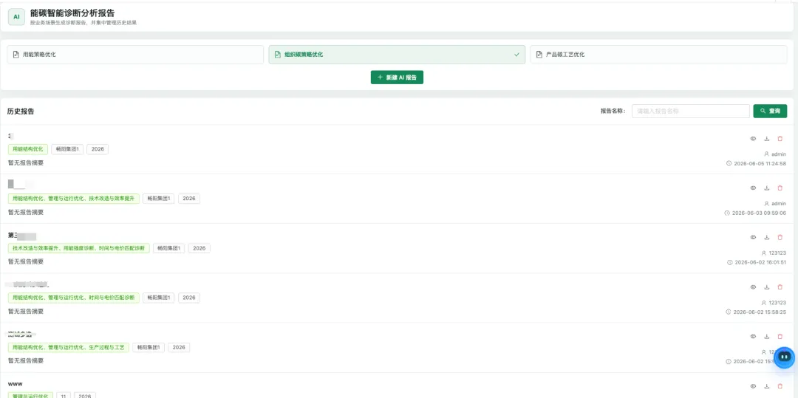

· 预测—诊断—策略闭环

用能预测与碳资产预测联动，把经验节能升级为可量化、可追踪的能效管理，真正支撑用能与碳排放预算管理。

**亮点二：符合国标的碳盘查行业模板**

碳盘查是企业碳管理的“家底审计”，但标准多、口径杂，往往让企业无从下手。碳能智云把规范“固化”成模板：

· 多标准内置，合规无忧

支持 GHG Protocol、ISO 14064 国际通用标准，以及国家 / 行业碳排放核算标准与公式算法，支持多标准切换与并行核算。

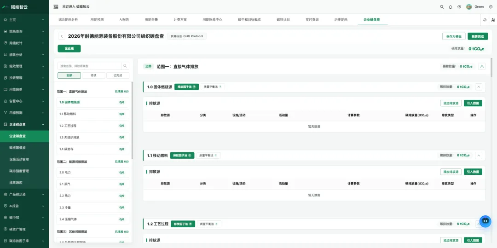

· 行业模板，开箱即用

内置碳盘查模板（系统预置 \+ 用户自定义），含行业核算边界、排放源、计算规则，符合 GB/T 32151 系列及生态环境部核算指南，快速套用、减少重复配置。

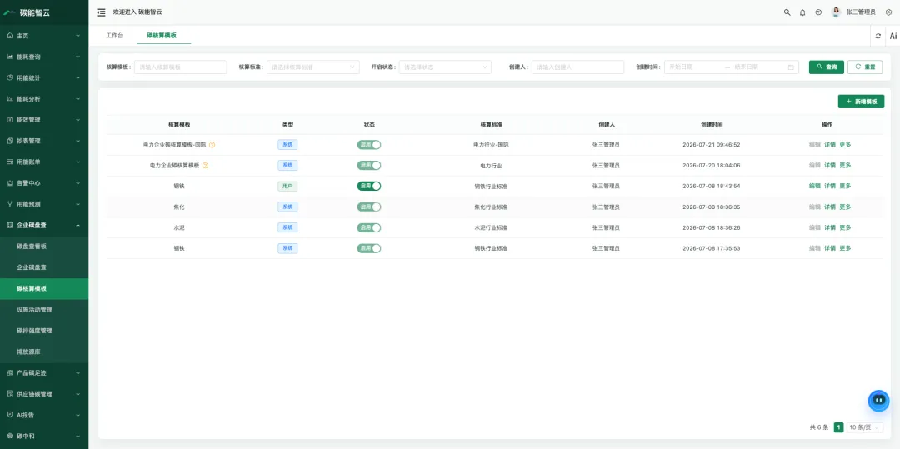

· 报告自动生成，支撑碳核查

一键生成标准企业碳盘查报告，过程数据可追溯、原始凭证可溯源，系统日志全程留痕，直接支撑碳核查材料汇集与导出。

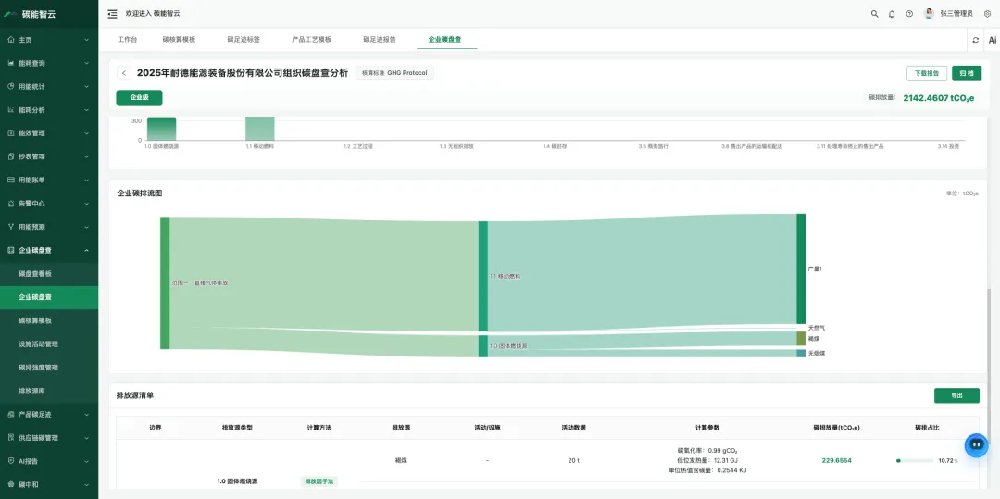

**亮点三：碳足迹报告中的工艺流程模板库**

产品碳足迹核算链条长、环节多，最难的往往是“从零搭流程”。碳能智云提供现成的工艺模板，让核算起步即规范：

· 行业典型工艺模板，直接引用

平台沉淀各行业典型产品生产工艺流程模板，包含工序流程、工艺环节及关联排放源，用户可直接选择引用，快速构建碳足迹核算流程。

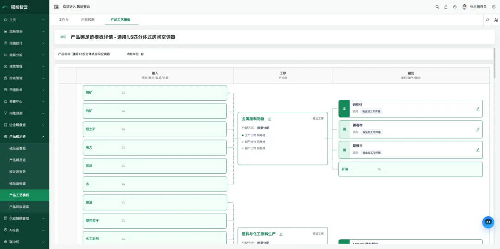

· 配套能力齐全，核算到交付闭环

结合产品排放源库、碳足迹标签（支持图片导出与二维码展示）、碳足迹报告自动生成，支撑产品碳标识认证、认证审核与绿色采购。

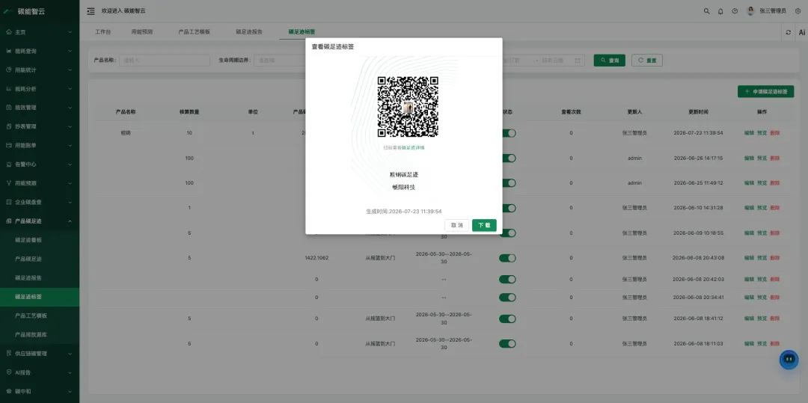

· 符合国标，对接国际规范

核算模型符合 GB/T 24067《温室气体产品碳足迹量化要求和指南》及对应细分产品碳足迹核算规则标准，满足国内外披露与合规需求。

**亮点四：一键生成碳盘查报告与碳足迹报告**

核算的终点不是数据，而是可被监管、客户与认证机构采信的报告。碳能智云把“核算—报告—交付”打通，组织与产品两端均支持标准报告自动生成：

· 碳盘查报告（组织层面）自动生成

基于国标行业模板的核算结果，自动生成符合 GHG Protocol、ISO 14064等要求的组织碳盘查报告，含排放清单、核算边界、数据溯源，支撑年度碳披露与监管报送。

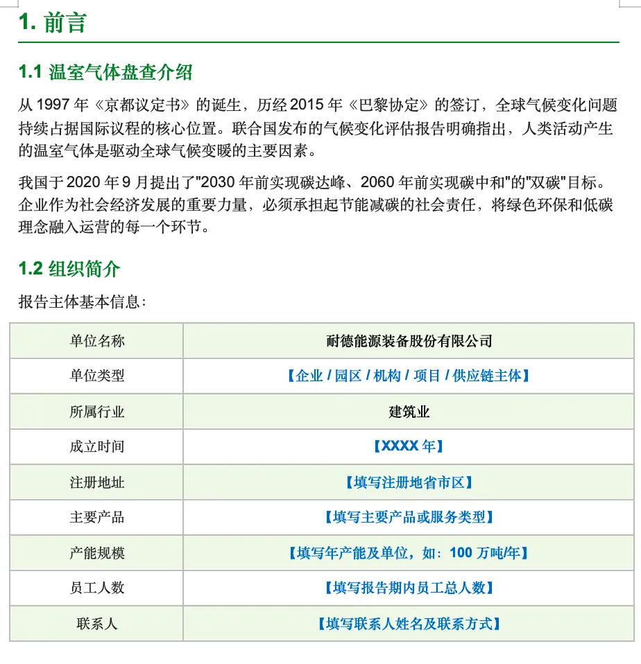

· 碳足迹报告（产品层面）自动生成

结合工艺流程模板与排放源库，自动输出产品碳足迹报告，符合 GB/T 24067，含生命周期各环节排放明细，可配套碳足迹标签（图片 / 二维码）用于产品碳标识与绿色采购。

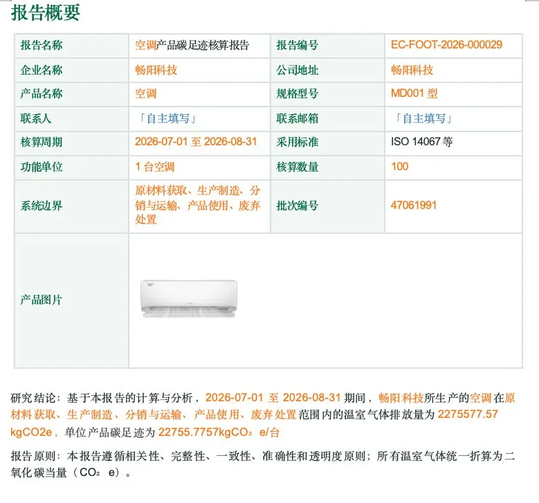

· 可导出、可追溯、可审计

报告支持 PDF / Word 导出，过程数据留痕、系统日志可追溯，满足碳核查与第三方认证的资料要求，让合规交付从“数周手工整理”变为“一键完成”。

## 移动端：能碳管理装进口袋

碳能智云不止于 PC 端可视化看板，更把能碳管理装进手机。

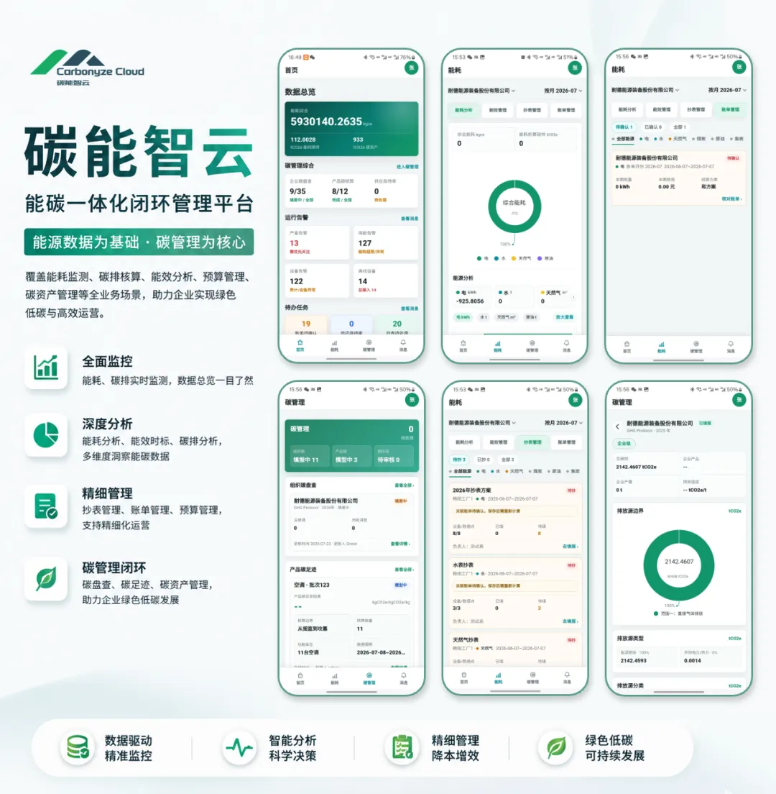

管理者与业务人员可随时随地看数据、处理待办。移动端包含四大核心板块：

首页

提供平台运营总览，集中展示企业能碳管理核心数据，包括总能耗、碳管理概况、运行告警及待办任务等关键指标，帮助用户快速掌握平台整体运行情况。

能耗看板

提供能源监测与分析驾驶舱，集成能耗分析、能效管理、抄表管理及账单管理等功能，支持查看综合能耗、能源占比、能耗趋势、能耗强度、分组排行、能效对标、能效考核及用能账单等信息，实现能源数据的统一分析与管理。

碳管理

提供企业碳管理综合门户，涵盖组织碳盘查、产品碳足迹及供应商碳管理等业务，支持查看碳盘查进度、产品碳足迹核算结果、供应商碳数据及相关详情，实现企业碳数据集中管理。

消息

统一管理平台运行消息，集中展示设备告警、能耗告警、碳管理提醒及待办任务等信息，支持消息查看、处理及状态跟踪，提升业务处理效率。

## 上架亮点

- **业务覆盖完整**：同时覆盖能源管理、碳核算、产品碳足迹、供应链碳协同、碳资产和碳中和业务。

- **支持二次开发**：源码模式适合进行行业模板扩展、业务流程定制、系统集成和本地化交付。

- **具备数据闭环**：从基础数据、计量采集、统计分析、核算报告到策略建议，形成完整管理链路。

- **面向集团协同**：集团协同版适合多组织、多核算主体、多租户和统一权限管理场景。
